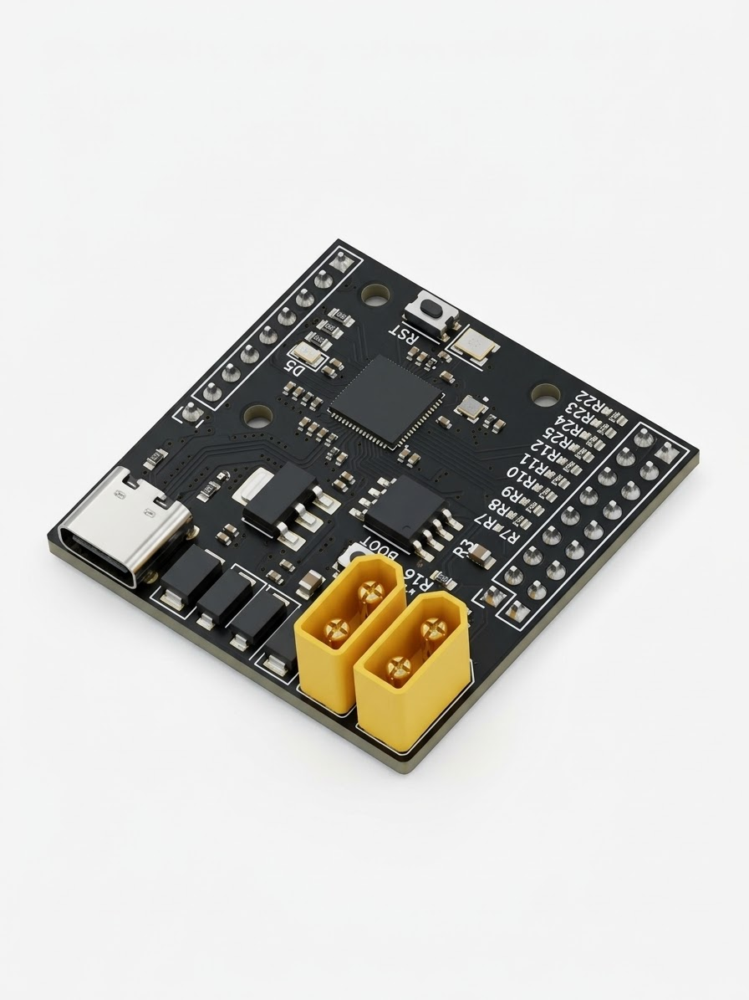
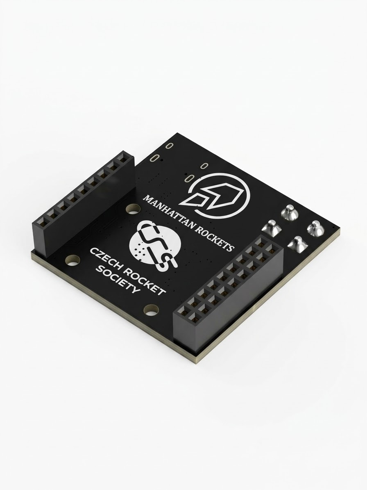
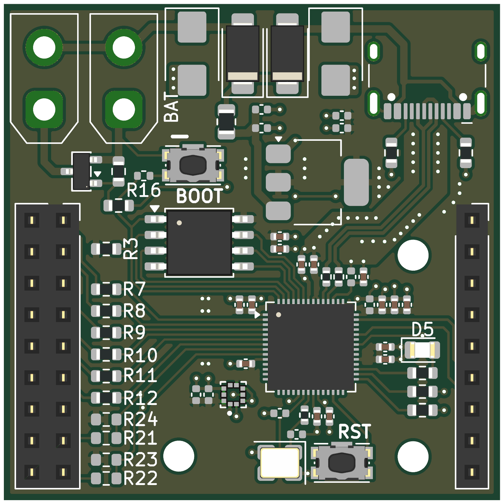
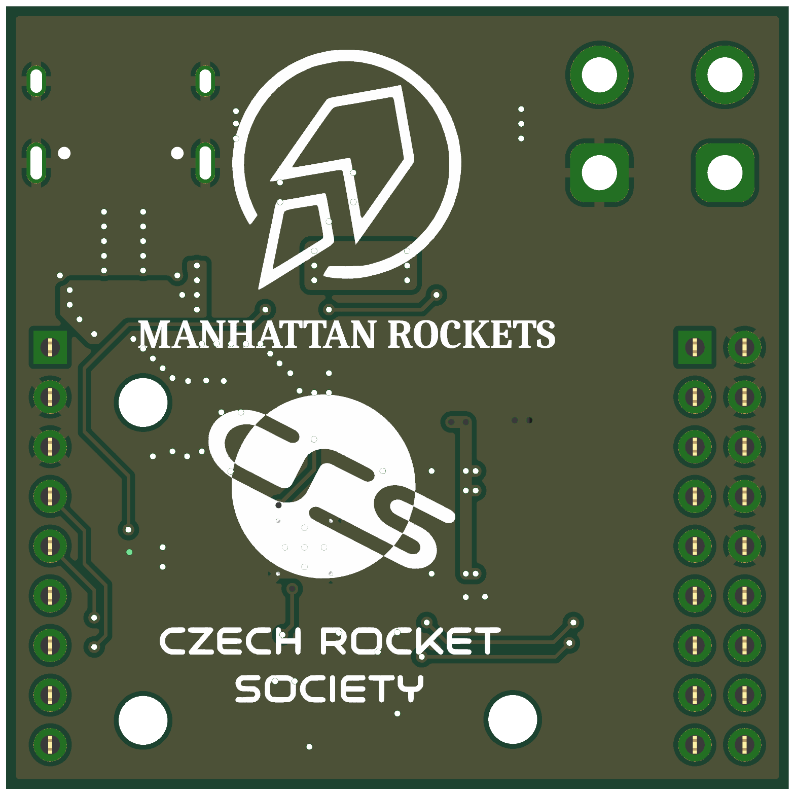

# RODIA Pathfinder

<p align="center">
  
  
</p>
<p align="center"><i>AI-generated visualisation of the PCB2.3 board: front (left) and back (right).</i></p>

**RODIA Pathfinder** is the first iteration of a custom RP2040 flight computer for
**Trinity**, the hybrid rocket-drone vehicle of the student team Manhattan Rockets
(Czech Rocket Society). It is a 40 × 40 mm, two-layer board designed in KiCad and
manufactured and assembled by JLCPCB.

Pathfinder is not meant to fly. It exists to prove the core of the design in hardware
(MCU, power, flash, barometer, pyro channel) before the more demanding
**RODIA** (*Rocket Onboard Drone Interface Avionics*) board is built.

Full documentation (Czech, 19 pages): [`MR_PCB2_DOCUM_FINAL.pdf`](MR_PCB2_DOCUM_FINAL.pdf)

## Board overview

| Parameter | Value |
|---|---|
| MCU | RP2040 (dual Cortex-M0+, no FPU) |
| Flash | W25Q128JVS, 16 MB, QSPI (firmware + sensor data) |
| Sensor | BMP388 barometer (I2C, address `0x76`) |
| Power | USB-C (5 V) or Li-Po 2S–3S via XT30, Schottky OR-ing + TVS protection on both inputs |
| Logic | 3.3 V, NCP1117-3.3 linear regulator |
| Pyro channel | AO3400A MOSFET, powered directly from the battery, XT30 output (J5) |
| Size | 40 × 40 mm, 1.6 mm, 2 layers, 3 × 2.5 mm mounting holes |
| Expansion | J3 (2 × 9) and J4 (1 × 9) pin headers, 2.54 mm, for stacking boards |

| 3D view, top | 3D view, bottom |
|---|---|
|  |  |

Full schematic: [`images/schematic.pdf`](images/schematic.pdf)

## Status

**Verified on hardware**
- Power from USB-C and from a 2S battery
- Firmware upload over USB (BOOT button, mass-storage mode)
- BMP388 barometer: 25 Hz logging, ±0.1 m noise
- BNO085 orientation sensor (on the extension board) sharing the I2C bus with the BMP388

**Known issues** (input for the next revision)
- J3 silkscreen GPIO labels are shifted by two (see [`rodia-pathfinder/AVIONICS.md`](rodia-pathfinder/AVIONICS.md))
- No SWD pads, so no hardware debugging
- Linear regulator dissipates ~0.9 W from a full 3S pack at 100 mA; a switching regulator would remove this
- SD card module on the extension board needs 5 V, which is not available in flight
- No flyback diode on the pyro channel: fine for a resistive e-match, not for inductive loads

## Repository structure

```
.
├── README.md
├── MR_PCB2_DOCUM_FINAL.pdf                 full Pathfinder documentation (Czech)
├── images/                                 renders, schematic blocks, copper layers
├── rodia-pathfinder/                       design files
│   ├── AVIONICS.md                         pin map, SPI rules, firmware build, hardware status
│   ├── PCB2.3_JF/                          main board: KiCad project + JLCPCB production files
│   ├── Sensor_board_1.2/                   extension board: BNO085, SD card, LEDs, buzzer
│   └── datasheets+components+min-design/   datasheets, component lists, RP2040 minimal reference design
└── rodia/                                  the next board
    ├── RODIA_project_brief_EN.pdf          motivation, idea, requirements
    └── RODIA_block_diagram.pdf / .odg      simplified system diagram
```

## What comes next: RODIA

Trinity flies a ballistic rocket ascent followed by a powered, controlled drone descent.
The drone flight controller handles the descent, but its firmware only provides filtered data
tuned for propeller flight, and its accelerometer is close to its range limit under rocket loads.
RODIA is a second, independent flight computer that connects to the drone flight controller,
follows drone-FC mechanical standards, logs raw sensor data, talks to the ground station
and can carry out the critical functions (parachute deployment) on its own if the drone FC
fails. See [`rodia/RODIA_project_brief_EN.pdf`](rodia/RODIA_project_brief_EN.pdf).

## About

Designed by **Vít Krejčí** (avionics, Manhattan Rockets, a student rocketry team operating
under the Czech Rocket Society).

Datasheets in `rodia-pathfinder/datasheets+components+min-design/` belong to their respective
manufacturers and are included for reference only.
